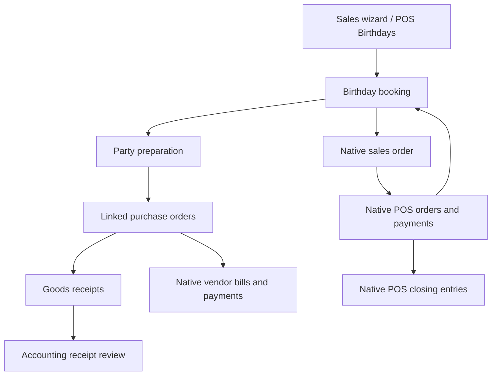
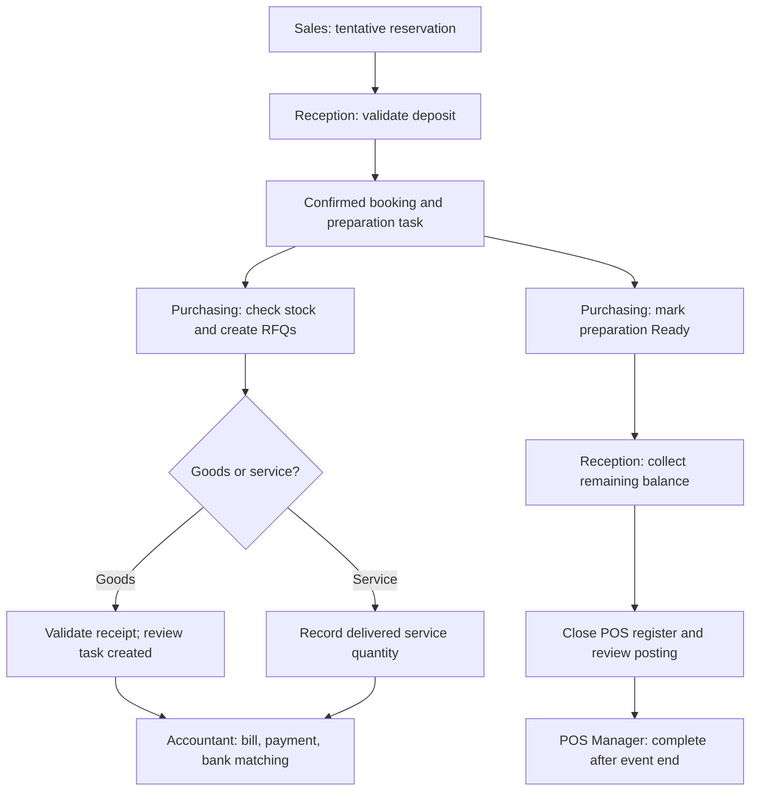

# Hopland Odoo Implementation

Implementor handover • 24 November 2026 • Intended repository: `ruknova/kidsland`

Hopland is an amusement-park implementation covering branch reception, admissions, birthday reservations, purchasing and accounting. The main demonstrated journey connects one birthday reservation to its customer payments, preparation, supplier orders and accounting records.

**Status:** working local demo, not a production sign-off. This document combines the reviewed birthday addon release with the demonstrated Windows workflow. The full live Windows project and database were not independently audited for this handover. Preserve the live `custom_addons` implementation, including the later customer-creation fix; extracted older packages are not the source of truth.

## 1. Environment and project structure

| Item | Current demo |
|---|---|
| Platform | Windows, VS Code, PowerShell |
| Project root | `C:\Users\Hamza\Desktop\Z\HopLand` |
| Odoo | Enterprise demo identified as 20.0; logs also contain `saas-19.5-1` asset identifiers. Pin the exact Community and Enterprise revisions before reproducing it. |
| URL / database | `http://localhost:8070` / `hopland_demo_v2` |
| Currency / timezone | SAR / `Asia/Riyadh` |
| Main demonstrated branch | Hopland - Al Yasmin, under Hopland Demo |
| Reception register | Hopland Yasmin - Reception |
| Python / configuration | `community\.venv_hopland\Scripts\python.exe` / `community\hopland.conf` |

Folders visible in the Windows project:

| Path | Purpose | Repository treatment |
|---|---|---|
| `custom_addons/` | Active project-owned Odoo modules | Include current source, excluding caches and backup files |
| `community/` | Odoo runtime/source, local environment and configuration | Keep vendor source, environment and secret configuration out of the custom-project import |
| `enterprise-20.0/` | Enterprise addons | Obtain separately through authorized Odoo access |
| `hopland_data/` | Local Odoo data directory; confirm its configured role | Do not commit runtime data or filestore |
| `birthday_addon_backups/` | Historical installation backups | Keep separately from Git |
| Extracted birthday reference/access fixes and department/receipt packages | Historical releases and installers | Reference material, not additional active addons paths |
| `APPLY_BIRTHDAY_ACCESS_FIX` PowerShell script | Earlier access-fix utility | Review before reuse; do not rerun patches blindly |

The birthday module's direct dependencies are `pos_sale`, `sale_management` and `purchase_stock`. Additional modules exist in the broader project; inventory them from the live `custom_addons` manifests before handover acceptance.

## 2. What has been implemented

- Branch-based birthday packages, rooms, included services, extras, guest counts and pricing.
- Central Sales reservation wizard and a custom POS **Birthdays** interface.
- Tentative reservations, room-overlap prevention, deposit collection and remaining-balance checkout.
- A linked native sales order, unique reservation references and retry/checkout controls.
- Purchasing preparation tasks after the deposit requirement is met; manually linked RFQs and purchase orders.
- Goods-receipt handoff to an Accounting review queue, including receipt snapshots and activities.
- Native vendor bills, payments, bank matching and POS closing entries demonstrated through departmental accounts.
- Manager-controlled party completion after the event end.

**Previously demonstrated, source not reviewed here:** admissions/visit records, paid-before-check-in control, expected exit/check-out, wristband fields, game-card top-ups and insufficient-points checks. Verify their addon names and installation instructions from the live project. WhatsApp installation/dependency work does not establish a completed integration. Salla, CRM and external messaging integration remain unverified.

## 3. Birthday module map

Reviewed release: `hopland_birthday_pos`, manifest version **20.0.1.2.0**. Paths below are relative to `custom_addons/hopland_birthday_pos/` in the intended live layout.

| File or folder | Responsibility |
|---|---|
| `__manifest__.py` | Dependencies, data files, POS assets and post-install hook |
| `models/catalog.py` | Packages, included services, rooms, POS configuration and birthday-product flags |
| `models/booking.py` | `hopland.birthday.booking`: pricing, customer creation, reservation, overlap checks, checkout and completion |
| `models/sales_wizard.py` | `hopland.party.sales.wizard`: Sales entry form, calculation and submission |
| `models/departments.py` | Sales source, preparation model, departmental activities and `purchase.order.hopland_booking_id` |
| `models/receipt_handoff.py` | `hopland.party.receipt.review` and the completed-stock-transfer hook |
| `models/pos_order.py` | POS synchronization checks and booking payment/status updates |
| `models/validation.py` | Shared input, date/time and overlap helpers |
| `static/src/birthday_dialog.*` | POS birthday form and bookings/balances interface |
| `static/src/pos_patch.js` | Native POS checkout integration |
| `static/src/department_notifications.js` | Reception notifications for Sales reservations |
| `views/`, `security/ir.access.csv` | Menus, forms, access permissions and company restrictions |
| `hooks.py`, `migrations/`, `data/sequence.xml` | Setup, upgrade/backfill logic and booking numbering |
| `tests/` | Odoo integration test definitions; requires a disposable test database |



## 4. Department users

These are demo accounts, not recommended shared production identities. Passwords are intentionally omitted.

| Login | Role and demonstrated access |
|---|---|
| `sales` | Hopland Sales: reservations and Sales documents. **Contact / Creation** is needed for new customers. |
| `purchasing` | Hopland Purchasing: Purchase User and Inventory User; supplier orders, receipts and preparation updates. |
| `account` | Hopland Accountant: Accounting Bookkeeper; standard **Purchase User** was also granted for PO selection/matching. This is broader purchasing access, not read-only access. |
| `posmanager` | Hopland POS Manager: general **User** role with **Point of Sale / Administrator**; reception checkout and party completion. |
| `admin` | Initial setup and maintenance; not the presentation operator. |

Select the correct branch in each account. Company rules limit custom records to allowed companies. POS Administrator is an application-level management role. Review actual company access and segregation of duties before production; the screenshot showed the POS account initially allowed both the parent and Al Yasmin.

## 5. Birthday workflow



Supplier billing/payment and preparation may progress separately. **Ready is a manual operational status**; the completion method checks payment and timing, not preparation readiness or supplier-bill payment.

### A. Sales → Reception

1. Open **Sales → Parties → New reservation**.
2. Select branch, reception register, package, event kind, room and available start time. End time follows the package duration; check the user timezone.
3. Select an existing **Parent / customer**, or leave it blank and fill **New customer name** and phone. Enter child name/age, children, adults, included services, extras and notes.
4. Click **Calculate price**, then **Save and send to Reception**. Record the generated BDAY reference. The booking is **Tentative**, with no payment recorded.
5. In POS, open **Birthdays → Bookings & balances**, find the reference and click **Collect deposit**. Validate Cash/Card payment through native checkout.
6. Meeting the deposit requirement changes the booking to **Confirmed**, creates preparation once and schedules departmental activities. Sales can reserve without an open POS session; reception checkout requires an open session.

### B. Purchasing → Accounting

1. Open **Purchase → Party preparation**, select the booking and set **Preparing**. Check available stock first.
2. Click **New RFQ for missing items**. Select supplier, products, quantities, prices, taxes and delivery date. Check the birthday link and confirm the order. RFQs are created manually, not automatically.
3. For goods, record actual received quantities and validate the stock receipt. For services, record received quantity after delivery; there is no warehouse receipt in the demonstrated service setup.
4. Complete the preparation checklist and set **Ready** manually.
5. Accounting opens **Purchase receipts**, checks the goods receipt against its PO and supplier document, adds notes and selects **Mark reviewed**. This marks the shared review and closes its generated review activities; an individual activity's Done button does not perform the same action.
6. In **Accounting → Vendors → Bills → New**, choose supplier and matching PO via **Auto-Complete**. Enter bill date/reference, check tax and quantity, then confirm.
7. Register payment using the appropriate journal. Match the actual bank outflow to that existing payment through **Bank Matching**. Demo bank transactions were entered manually. Do not create duplicate payments.

Receipt reviews do **not** generate/post bills or payments. They snapshot actual transferred items but display the **full PO total**, not a partial-receipt valuation. Partial receipts and supplier returns have separate reviews; reprocessing the same transfer is protected against duplicates. Non-stock services are outside this receipt-triggered handoff.

### C. Reception → Completion

1. In **Bookings & balances**, select **Pay remaining balance**, verify the amount and validate payment. Check paid total and zero remaining balance.
2. Close the register using the actual cash count, including opening cash and recorded cash movements. Review discrepancies, obtain the Z Report and close the session.
3. Accounting verifies the posted POS closing entry and reviews its assigned payment activities.
4. In **Point of Sale → Birthdays → Birthday Reservations**, the POS Manager selects **Complete party** after the scheduled end. The booking must be Confirmed, have zero balance and have no open checkout.

## 6. Demonstrated examples

| Item | Demo value |
|---|---|
| Customer package | 10 children: 990 SAR |
| Customer extras | Cake 150 SAR + photographer 300 SAR |
| Customer total / deposit / balance | 1,440 / 720 / 720 SAR; demo customer prices include VAT |
| Supplier cake purchase | 150 + 22.50 VAT = 172.50 SAR |
| Supplier photographer purchase | 450 + 67.50 VAT = 517.50 SAR |
| Earlier full scenario | BDAY/2026/00004, sales order S00008; cake P00002 and photographer P00003 |
| Latest rehearsal | BDAY/2026/00005, S00009; cake P00004; bill BILL/2026/11/0003; payment PBNK1/2026/00004 |

The latest cake bill was verified **Paid**, 172.50 SAR, zero due. Photographer purchasing was intentionally skipped for that rehearsal while retaining the customer's 1,440 SAR total. This is a simulation shortcut, not evidence that all supplier services were procured. Final customer payment, register closing and completion for BDAY/2026/00005 were instructed but not subsequently verified in this handover.

BDAY/2026/00004 was rescheduled through a one-time shell adjustment to demonstrate completion; the change was recorded in chatter. Service receipt/readiness was also simulated. Normal operation must use actual delivery and event times. Historical demo cash corrections must not be reused as production opening balances.

## 7. Known fixes and troubleshooting

| Symptom | Resolution / check |
|---|---|
| New customer gives Contact access error | Grant the Sales user **Contact / Creation**; existing customer selection is a separate path. |
| `Invalid field 'company_type' in 'res.partner'` | Live hotfix removed `'company_type': 'person'` from `_partner()` in `models/booking.py`, retaining `customer_rank: 1`. A new reservation then succeeded. The reviewed extracted 1.2.0 package still contains the old field: preserve the corrected live file before pushing. |
| Room unavailable | Tentative/active overlapping reservations can hold the room. Choose a genuinely available time; do not bypass the check. |
| Bill has zero due but remains In Payment | Check the outstanding payment's bank match. The latest demo used -172.00 instead of -172.50; undoing the match, correcting that simulated transaction and matching again produced Paid. |
| Customer name search returns No records | Use **New customer name**, not the existing-customer selector, for a new customer. |
| Unexpected cash loss/correction | Compare opening cash, actual drawer count and recorded cash movements. Zero opening cash can create a discrepancy when prior cash remains. |
| Missing Complete party button | Check POS Manager permission and booking state. |
| Party has not ended yet | Completion waits for the stored end time. No normal rescheduling interface is implemented in the reviewed form. |
| Multiple review reminders | Different payment updates generate activities; eligible Administrator accounts may also receive them. Distinguish payment activities from the shared receipt review queue. |

## 8. Start, reproduce and validate

Start the existing local environment with PostgreSQL already running:

```powershell
Set-Location "C:\Users\Hamza\Desktop\Z\HopLand\community"
& ".\.venv_hopland\Scripts\python.exe" ".\odoo-bin" "-c" ".\hopland.conf"
```

Verify the configuration locally: database connection, data directory and addons paths must point to the intended Community, Enterprise and active custom modules. Do not paste credentials into Git or this README. Confirm the exact Python/PostgreSQL versions and dependency set from the live machine; they were not established by this document.

**A source checkout is not a complete demo restore.** Reproduction requires compatible Odoo revisions, licensed Enterprise access, dependencies, private configuration and either the demo database **plus its filestore** or a documented fresh configuration process. Users, companies, products, rooms, journals and most demo transactions live in the database. Check the Enterprise subscription status separately.

The receipt release documentation reports 14 lightweight handoff tests, 12 workflow checks and 8 POS notification assertions, plus syntax/XML/access checks. These are release-reported results, not a fresh full-system certification. `tests/` contains integration tests; no live Odoo/PostgreSQL test suite was executed while preparing this README.

Before production handover:

- Inventory every active custom addon and pin runtime/Enterprise revisions; preserve the live hotfix.
- Restore database and filestore into an isolated test environment and verify startup.
- Rehearse new/existing customers, room collisions, deposits, partial/final payment, refunds, goods/service receipt and completion using departmental users.
- Verify cross-company access, review deduplication, taxes, journal configuration, opening balances and accounting reports.
- Reconcile test evidence with actual installed versions; confirm admissions/points and integration scope separately.
- Retain source, database and filestore backups together before upgrades. Do not run historical installers or migrations simply to start the project.

This README is documentation only. Creating it does not modify the application or database, and does not commit or push the repository.
